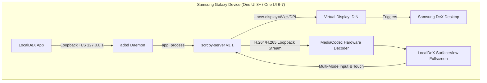

# LocalDeX

Run Samsung DeX **entirely on your Galaxy device's own screen** — no dock, no cable, no computer, no root.

**LocalDeX** is a Free and Open Source Software (FOSS) Android application written in **100% Kotlin**. It creates an on-device virtual display on your phone or tablet, enables Samsung One UI to launch the native DeX desktop environment directly on it, and decodes the desktop video stream fullscreen with zero-latency hardware acceleration and multi-mode mouse/touch interaction.

---

## Architecture Overview



### Key Technical Mechanisms
1. **Loopback ADB over TLS (`127.0.0.1`):** Uses Android 11+ Wireless Debugging and mDNS (`NsdManager`) to pair and connect the app directly to the device's own ADB daemon over localhost. Zero data ever leaves the device.
2. **Self-Healing Permission Grant:** After the one-time pairing, LocalDeX grants itself `android.permission.WRITE_SECURE_SETTINGS` via loopback ADB shell. Because Android disables Wireless Debugging across reboots or Wi-Fi network switches, holding this permission allows LocalDeX to automatically re-enable `adb_wifi_enabled = 1` via `Settings.Global`.
3. **Virtual Display Creation:** Pushes bundled `scrcpy-server` (v3.1) to `/data/local/tmp/scrcpy-server.jar` and launches it via `app_process` with `--new-display=<WIDTH>x<HEIGHT>/<DPI>`. Samsung One UI detects this virtual display as an external monitor and launches the full Samsung DeX desktop environment on Display ID `N`.
4. **Native Low-Latency Video Pipeline:** Decodes H.264/H.265 using hardware `MediaCodec` (`KEY_LOW_LATENCY = 1`) directly onto a `SurfaceView`. Translates gestures, stylus pressure, hardware mouse, and gamepad events into scrcpy control packets targeting Display ID `N`.

---

## Features

- **100% On-Device & FOSS:** No external monitor, dock, PC, or cables required. Free and Open Source under GPL-3.0 with zero proprietary trackers or closed dependencies.
- **Self-Healing Loopback ADB:** One-time pairing automatically grants `WRITE_SECURE_SETTINGS` to maintain Wireless Debugging across reboots.
- **Multi-Mode Input Engine:**
  - **Virtual Trackpad:** 1-finger glide to move cursor, 1-finger tap to left-click, 1-finger drag to move windows, 2-finger scroll for mouse wheel, and 2-finger tap for right-click.
  - **Direct Touch:** Direct multi-touch interaction with DeX desktop windows.
  - **S-Pen & Stylus:** Precision point-and-click, 4096-level pressure sensitivity pass-through, S-Pen side button for right-click/eraser, and air hover cursor tracking.
  - **Hardware Mouse & Pointer Lock:** Connect any Bluetooth or USB mouse and toggle pointer capture lock to navigate without Android cursor boundary trapping.
  - **Gamepad & Controller:** Analog cursor navigation with left stick, smooth scrolling with right stick, D-pad hat mapping, and Button A click injection.
- **Galaxy Z Fold Awareness:** Integrated Jetpack WindowManager posture tracking. Automatically adapts between Cover screen (`2316x904/380`), Inner screen (`2176x1812/360`), and Tabletop Flex Mode.
- **One UI Desktop Enhancements:** Enables edge-resizable freeform floating windows (`enable_freeform_support` and `force_resizable_activities`).
- **Floating Session Pill Toolbar:** Translucent, draggable toolbar with auto-dimming (35% opacity when idle) and anti-occlusion soft keyboard tracking.
- **Native Speaker Audio:** Device speakers play DeX audio natively with zero latency by default; optional loopback Opus/AAC audio stream forwarding available in profile settings.
- **Secondary Display Mirroring:** View and control the active DeX session from a computer using standard `scrcpy --display-id=<N>`.

---

## Requirements

- **Device:** Samsung Galaxy smartphone or tablet running **One UI 8 or later** (desktop mode on virtual displays) or One UI 6 / 7.
- **OS:** Android 11+ (Wireless Debugging support).
- **Network:** Connected to an active Wi-Fi network (required by Android's internal `adb_wifi` service to bind localhost sockets; no network traffic leaves the phone).
- **Permissions:** Notification permission (used for the 6-digit pairing PIN inline reply).

---

## Setup Guide

1. **Install LocalDeX:**
   Download and install the APK (`LocalDeX-v1.0.0-universal.apk` or `LocalDeX-v1.0.0-debug-universal.apk`).
2. **Enable Developer Options:**
   Open **Settings → About phone → Software information**, then tap **Build number** 7 times until Developer options is unlocked.
3. **Follow the Onboarding Checklist:**
   - Open LocalDeX and allow notifications (needed to receive the pairing code input prompt).
   - Tap **Start Pairing** — LocalDeX opens Developer options.
   - Navigate to **Wireless debugging → Pair device with pairing code**.
   - Type the 6-digit pairing code into the LocalDeX notification's inline reply field and submit.
4. **Launch Samsung DeX:**
   Select your preferred display profile (e.g. 1080p, 1440p, Fold Cover, Fold Inner, or custom) and tap **Start DeX**.

> [!NOTE]
> Pairing is a one-time operation. LocalDeX automatically grants itself `WRITE_SECURE_SETTINGS` over its loopback connection so it can silently re-enable Wireless Debugging if Android turns it off after a reboot or network change.

---

## Usage & Interaction

### Display Profiles
Display specifications follow the scrcpy format: `WIDTHxHEIGHT/DPI`:
- **1080p Standard:** `1920x1080/240` (balanced desktop viewport)
- **1440p WQHD:** `2560x1440/280` (maximum screen real estate)
- **Galaxy Z Fold (Cover Screen):** `2316x904/380`
- **Galaxy Z Fold (Inner Screen):** `2176x1812/360`
- **Custom Profile:** Configure custom resolution, DPI (120–480), refresh rate (60/120 FPS), bitrate (8–32 Mbps), video codec (H.264/H.265), and audio capture in the Profile Editor.

*Tip: A lower DPI gives you more desktop room for windowed apps; a higher DPI makes UI elements and text larger.*

### Input Controls
| Input Mode | Action | Behavior |
| :--- | :--- | :--- |
| **Virtual Trackpad** | 1-finger glide | Moves the virtual DeX desktop cursor |
| | 1-finger tap | Left click |
| | 1-finger drag | Drags windows by their title bar handles |
| | 2-finger swipe | Vertical and horizontal scroll wheel |
| | 2-finger tap | Right click |
| **Direct Touch** | Touch & gestures | Direct multi-touch interaction with DeX windows |
| **S-Pen / Stylus** | Tip touch | Direct precision click and drag |
| | Pressure | 4096-level hardware pressure sensitivity pass-through |
| | Side button / Eraser | Secondary click (Right-click) / Eraser |
| | Air hover | Desktop cursor follows stylus tip in mid-air |
| **Hardware Mouse** | Left/Right/Middle click | Native mouse button pass-through |
| | Scroll wheel | Smooth vertical and horizontal scrolling |
| | Pointer Capture | Locks cursor into DeX for boundary-free PC navigation |
| **Gamepad** | Left Analog Stick | Smooth desktop cursor gliding |
| | Right Analog Stick | Webpage & window scrolling |
| | D-Pad Hat Switch | Arrow keys navigation |
| | Button A | Primary click at cursor position (Trackpad mode) |

### Navigation & Toolbar
- **System Back Navigation:** Android Back gestures and hardware Back buttons are forwarded directly to Samsung DeX Display ID `N` rather than closing the viewer.
- **Floating Session Pill:** Translucent, draggable floating pill toolbar:
  - Tap the drag handle to expand the quick menu: toggle between Trackpad and Direct Touch, lock/unlock mouse pointer, toggle soft keyboard, or stop DeX.
  - Auto-dims to 35% opacity after 3 seconds of inactivity.
  - Automatically raises above Android's on-screen keyboard when typing.
- **Background Persistence:** Pressing the Home button minimizes the viewer while Samsung DeX continues running. Return to the session or stop it at any time via the persistent notification or the Quick Settings tile.

---

## Viewing DeX from a Computer

Because the DeX session runs on a standard Android secondary virtual display, any computer connected via ADB can view and interact with the same running DeX desktop using upstream `scrcpy`:

```bash
scrcpy --display-id=<N>
```

The active Display ID `N` is displayed on the LocalDeX home screen and in the persistent notification (e.g. *"DeX Active (Display 7)"*).

---

## Windowed Apps & Window Controls

Apps in Samsung DeX run in resizable floating windows:
- **Title Bar Drag Handle:** Drag to reposition the window across the desktop.
- **Edge Resizing:** Drag any window border or corner to resize.
- **Handle Menu:** Tap the top handle for minimize, maximize, and split-screen controls.
- **Freeform Windows:** LocalDeX automatically configures `enable_freeform_support` and `force_resizable_activities` in Developer options so all installed apps can be freely resized in DeX mode.

---

## Repository Structure

```
LocalDeX/
├── .github/
│   ├── dependabot.yml         # Automated dependency bump configuration
│   └── workflows/
│       └── build-apk.yml      # CI workflow for release-triggered APK builds
├── app/                       # Android application module
│   ├── build.gradle.kts       # Application build configuration & R8 rules
│   ├── src/main/assets/       # Bundled scrcpy-server v3.1 JAR (SHA-256 verified)
│   ├── src/main/java/org/localdex/
│   │   ├── data/              # DataStore preferences & DisplayProfileRepository
│   │   ├── service/           # DexSessionService, PairingReplyReceiver, DexTileService
│   │   ├── ui/                # Compose screens, M3 Theme, ViewerActivity, Pill Toolbar
│   │   │   ├── foldable/      # Jetpack WindowManager FoldablePostureTracker
│   │   │   ├── home/          # HomeScreen & Hero Status Card
│   │   │   ├── profile/       # ProfileEditorSheet & Wireframe Preview
│   │   │   ├── setup/         # SetupWizardSheet & Desktop Flag Toggles
│   │   │   └── viewer/        # DexViewerActivity & SessionPillToolbar
│   │   └── LocalDeXApp.kt     # Application class
│   └── AndroidManifest.xml
├── core/
│   ├── adb/                   # Loopback ADB over TLS 1.3 module
│   │   └── src/main/java/org/localdex/core/adb/
│   │       ├── connection/    # AdbConnection, AdbStream
│   │       ├── crypto/        # AdbCrypto (RSA-2048 & X.509 certificates)
│   │       ├── discovery/     # AdbDiscoveryManager (mDNS pairing & connect listener)
│   │       ├── pairing/       # AdbPairingClient (SPAKE2+ TLS 1.3 handshake)
│   │       ├── permission/    # AdbPermissionManager (WRITE_SECURE_SETTINGS)
│   │       └── protocol/      # AdbMessage (24-byte packet framing & checksums)
│   └── scrcpy/                # Video streaming demuxer & desktop input engine
│       └── src/main/java/org/localdex/core/scrcpy/
│           ├── control/       # ControlMessage, ControlSocketWriter
│           ├── decoder/       # VideoStreamDecoder (low-latency MediaCodec)
│           ├── input/         # InputEngine (Trackpad, Touch, S-Pen, Mouse, Gamepad)
│           ├── model/         # DisplayProfile & Display presets
│           └── server/        # ScrcpyServerManager (process spawner & binary verification)
├── fastlane/metadata/android/ # Triple-T store metadata for F-Droid and IzzyOnDroid
├── metadata/                  # F-Droid build recipe template (org.localdex.yml)
├── gradle/
│   └── libs.versions.toml     # Gradle Version Catalog (Kotlin 2.1.0, compileSdk 36)
├── build.gradle.kts           # Root build script
├── settings.gradle.kts        # Module inclusions
├── LICENSE                    # GNU General Public License v3.0
├── PENDING.md                 # Roadmap and milestone tracking
└── README.md
```

---

## Building from Source

### Prerequisites
- Linux, macOS, or GitHub Codespaces
- OpenJDK 17 (`JAVA_HOME`)
- Android SDK (`compileSdk = 36`, `build-tools;36.0.0`, `platforms;android-36`)

### Commands
```bash
# Run all unit tests across modules
./gradlew test --stacktrace

# Build Debug APK
./gradlew assembleDebug

# Build Universal Release APK (ProGuard / R8 shrunk)
./gradlew assembleRelease
```

### APK Output Paths
- **Debug:** `app/build/outputs/apk/debug/LocalDeX-v1.0.0-debug-universal.apk`
- **Release:** `app/build/outputs/apk/release/LocalDeX-v1.0.0-universal.apk`

### Troubleshooting ADB Installation
If installation over ADB is blocked with `INSTALL_FAILED_VERIFICATION_FAILURE`:
```bash
adb shell settings put global verifier_verify_adb_installs 0
adb install -r app/build/outputs/apk/release/LocalDeX-v1.0.0-universal.apk
adb shell settings put global verifier_verify_adb_installs 1
```

---

## Notes & Limitations

- **Wi-Fi Requirement:** Android's internal `adb_wifi` daemon only initializes while connected to an active Wi-Fi network. No network traffic leaves the phone; the connection binds exclusively to localhost (`127.0.0.1`).
- **Audio Routing:** DeX audio routes naturally through the device's internal speakers by default without loopback encoding overhead. Scrcpy loopback audio streaming (Opus/AAC) can optionally be toggled in profile settings.
- **Single Active Session:** Only one DeX session can run on the virtual display at any given time.

---

## License

**LocalDeX** is Free and Open Source Software licensed under the [GNU General Public License v3.0](LICENSE).

- `scrcpy` is developed by Genymobile and licensed under [Apache License 2.0](https://github.com/Genymobile/scrcpy/blob/master/LICENSE).
- Loopback cryptography powered by BouncyCastle (Bouncy Castle Licence / MIT).
