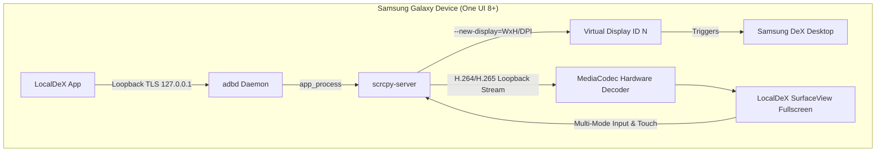

# LocalDeX (FOSS)

**LocalDeX** is a Free and Open Source Software (FOSS) Android application written in **100% Kotlin** that runs **Samsung DeX natively on a Samsung Galaxy device's own screen**—requiring **no external monitor, no dock, no USB cable, no PC, and no root access**.

---

## Architecture Overview



### Key Technical Mechanisms
1. **Loopback ADB over TLS (`127.0.0.1`):** Uses Android 11+ Wireless Debugging and mDNS (`NsdManager`) to pair and connect the app to the device's own ADB daemon over localhost without data leaving the device.
2. **Self-Healing Permission Grant:** After the first ADB connection, LocalDeX grants itself `android.permission.WRITE_SECURE_SETTINGS` via loopback shell to automatically re-enable `adb_wifi_enabled` via `Settings.Global` across reboots or Wi-Fi changes.
3. **Virtual Display Creation:** Pushes bundled `scrcpy-server` and launches it via `app_process` with `--new-display=<WIDTH>x<HEIGHT>/<DPI>`. Samsung One UI detects this virtual display as an external monitor and launches DeX.
4. **Native Low-Latency Video Pipeline:** Connects directly to local scrcpy sockets, decodes via hardware `MediaCodec` (`KEY_LOW_LATENCY = 1`) onto a fullscreen `SurfaceView`, and injects desktop pointer, touch, and keyboard events into Display ID `N`.

---

## Repository Structure

```
LocalDeX/
├── .github/workflows/
│   └── build-apk.yml          # GitHub Actions CI building debug & release APKs
├── app/
│   ├── build.gradle.kts       # Compose M3, DataStore, Universal APK output
│   └── src/main/
│       ├── assets/            # Bundled scrcpy-server binary
│       ├── java/org/localdex/
│       │   ├── ui/            # Compose screens, M3 Theme, ViewerActivity, Pill Toolbar
│       │   ├── service/       # DexSessionService, PairingReplyReceiver, DexTileService
│       │   └── data/          # DataStore DisplayProfileRepository
│       └── AndroidManifest.xml
├── core/
│   ├── adb/                   # mDNS discovery, TLS 1.3/SPAKE2+ pairing, loopback shell
│   └── scrcpy/                # Protocol framing, MediaCodec decoder, desktop input engine
├── gradle/libs.versions.toml
├── build.gradle.kts
├── settings.gradle.kts
├── LICENSE                    # GNU General Public License v3.0
└── README.md
```

---

## Building in GitHub Codespaces

1. Open this repository in a GitHub Codespace (or a Linux environment with JDK 17+ and Android SDK).
2. Run unit tests:
   ```bash
   gradle test
   ```
3. Build debug and release universal APKs:
   ```bash
   gradle assembleDebug assembleRelease
   ```
4. Output APKs will be located in:
   - `app/build/outputs/apk/debug/LocalDeX-v1.0.0-debug-universal.apk`
   - `app/build/outputs/apk/release/LocalDeX-v1.0.0-universal.apk`

---

## License

LocalDeX is licensed under the [GNU General Public License v3.0](LICENSE).
scrcpy is developed by Genymobile and licensed under Apache-2.0.
